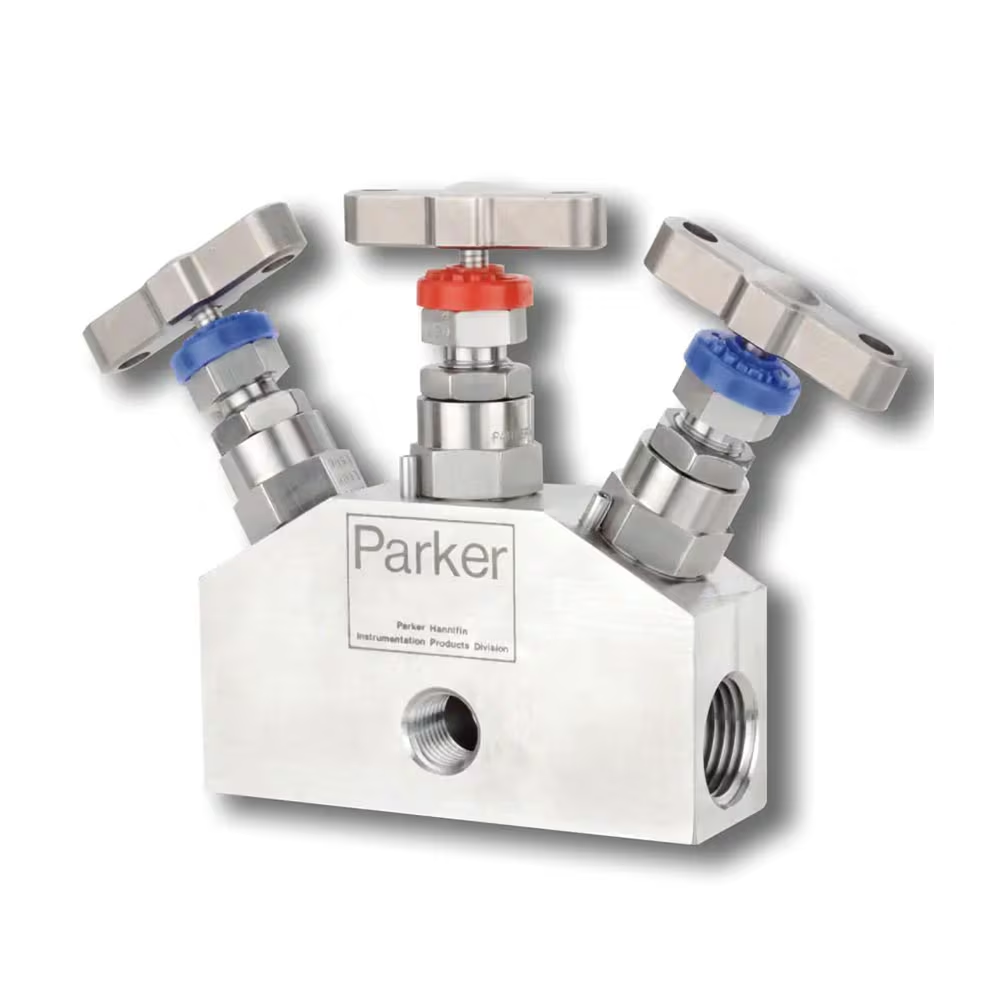
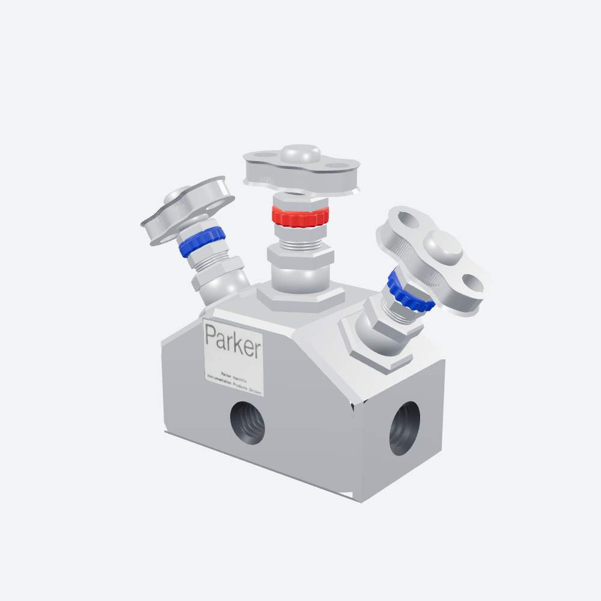

# photo2glb

从**一张产品照片**重建程序化网格并导出**米制 GLB** 的技能包（agent skill + 可运行 Python）。
纯 numpy 手写 glTF 2.0 / GLB 二进制，不依赖 trimesh、pygltflib 之类的库。

---

## 效果：Parker 三阀仪表管接头

| 输入：单张照片 | 输出：程序化重建的 GLB（three.js 真实渲染） |
|---|---|
|  |  |

| 指标 | 值 |
|---|---|
| 文件 | [`examples/parker_manifold_3valve.glb`](examples/parker_manifold_3valve.glb) · 1 746 KB |
| 三角面 | 27 112 |
| 节点 / 网格 / 图元 | 6 / 5 / 30 |
| 材质 | 6（不锈钢、机加工面、内螺纹腔、红聚合物、蓝聚合物、铭牌贴图） |
| 包围盒 | 108 × 80 × 40 mm（导出时根节点 ×0.001 转米制） |
| 导出自检 | `nodes: 6, meshes: 5, tris: 27112, problems: []` |

重建内容：六角块体（前后倒角 + 长侧面）、正面/左右端面三处内螺纹接口（暗腔 + 封底）、
居中竖直阀（六角底座 → 阀体鼓 → 双螺母 → 螺纹颈 → 红色滚花色环 → 六角压帽 → 阀杆 → 长圆板手轮）、
左右 ±34° 斜置阀（蓝色滚花色环、手轮略小）、正面 Parker 铭牌（从照片透视校正出的贴图）。

---

## 快速开始

```bash
git clone https://github.com/xvbai0317/photo2glb.git
cd photo2glb
pip install numpy pillow
python examples/build_manifold.py
```

输出（可复现，逐字节一致）：

```text
GLB examples/parker_manifold_3valve.glb  1746.1 KB  tris=27112 nodes=6 meshes=5 label=(420, 360)
```

写入器自检：

```bash
python scripts/glb_writer.py --self-test ./out
# winding violations: 0
# glb: ./out/demo.glb {..., 'tris': 8140, 'problems': []}
# self-test OK
```

---

## 真实渲染验证（必做，别只信自写软光栅）

```bash
python -m http.server 8777
chrome --headless=new --use-angle=swiftshader --hide-scrollbars \
       --window-size=1000,1000 --virtual-time-budget=25000 \
       --screenshot=shot.png \
       "http://127.0.0.1:8777/assets/verify_viewer.html?model=examples/parker_manifold_3valve.glb&az=38&el=18"
```

`assets/verify_viewer.html` 参数：`model`、`az`、`el`、`dist`（0 = 自动取景）、`fov`、`w`、`h`。
页面自带**影棚 IBL**（灰阶渐变穹顶 + 三个柔光箱经 PMREM）：金属只反射环境，
在暗环境里 `metallic≈1` 一定发黑，所以验证时必须用明亮环境。

逐项和照片比对：金属是否发亮、色环/贴纸方向、接口是不是暗孔（而非白盘/透空）、
把手轮廓是否同形；至少抓 `az=0`、`az=±38`、俯视三个角度。

---

## 作为 skill 使用

把四个文件放进项目技能目录即可被 agent 直接调用：

```text
<workspace>/.trae/skills/photo-to-glb/
├── SKILL.md                     # 流程 + 五条硬约束 + 完成检查表
├── scripts/glb_writer.py        # GLB 写入器 + 9 个几何生成器 + verify_glb
├── references/geometry-patterns.md
└── assets/verify_viewer.html
```

SKILL.md 的 7 个步骤：**测量 → 分层 → 建模 → 五条硬约束 → 写 GLB → 真实渲染验证 → 交付**。

---

## 五条硬约束（每一条都是真实踩过的坑）

1. **绕序必须与法线同向** —— 判方向只能看「几何法线 vs 顶点法线求和」，只看 `outward` 参数会在锥面/内腔上判反，表现为正面被剔除、孔变「透空」。
2. **内腔（孔 / 沉孔）要做成封闭体** —— 法线朝轴心 + 绕序跟随 + 端面封底。
3. **材质键名必须是 `pbrMetallicRoughness`** —— 写成 `pbr` 会静默退化成默认白色金属。
4. **POSITION accessor 必须有 `min`/`max`**；bufferView `target` 用 34962/34963；JSON 块补空格、BIN 块补 0，双块 4 字节对齐。
5. **`baseColorFactor` 是线性值** —— sRGB 取 `pow 2.2`；贴图保持 sRGB，UV 的 `v=0` 在图像顶部。

更多生成器用法与其余坑见 [`references/geometry-patterns.md`](references/geometry-patterns.md)。

---

## 目录结构

```text
.
├── SKILL.md                         技能说明与工作流
├── scripts/
│   └── glb_writer.py                GLB 写入器 / 几何生成器 / 自检 / verify_glb
├── references/
│   └── geometry-patterns.md         车削、六角、滚花、螺纹、沉孔、带孔平面、条带多孔板、倒角棱柱
├── assets/
│   └── verify_viewer.html           three.js 验证页（影棚 IBL、自动取景）
├── examples/
│   ├── build_manifold.py            完整可复现案例（单文件、自带写入器）
│   ├── label.png                    从照片透视校正出的铭牌贴图
│   └── parker_manifold_3valve.glb   示例产物
└── docs/
    ├── reference.png                输入照片
    └── render.png                   渲染结果
```

---

## 已知限制

- 单视角照片：背面、内腔、流道均为对称/常规结构**推断**，不是实测。
- 程序化重建，不是摄影测量/扫描；尺寸精度取决于照片里能找到的标尺。
- 观感依赖 IBL：不同查看器的环境光不同，金属会明显变色（暗环境偏黑、默认环境偏灰）。
- 示例模型为学习用途的产品形状复刻，商标与铭牌归 Parker Hannifin 所有。
